<div align="center">


# Strix

**A complete network security toolkit in your pocket.**
<br>
Discover, scan, test and exploit the devices on your network, right from an Android phone.

<br>

[](https://github.com/daboynb/strix/releases/latest)
[](https://github.com/daboynb/strix/stargazers)
[](LICENSE)


<br>

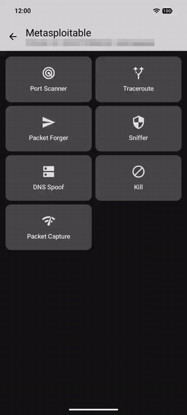

</div>

---

## What is Strix?

Strix turns a rooted Android phone into a portable penetration-testing lab. It is a modern rewrite of the ideas behind [cSploit](https://github.com/cSploit/android), rebuilt from scratch for today's Android.

You don't need to install anything else. **Nmap, Hydra, Ettercap, tcpdump and arpspoof come inside the app**, and the full **Metasploit Framework** is one tap away. Everything is driven from a clean touch interface: no terminal, no commands to remember.

> [!WARNING]
> **Use Strix only on networks and devices you own, or that you have written permission to test.**
> Scanning or attacking systems without authorization is illegal in most countries.

## Features

| Feature | What it does |
|---|---|
| **Host discovery** | Finds every device on your Wi-Fi in seconds (ARP scan), with name, MAC address and manufacturer |
| **Port & service scan** | Nmap frontend: open ports, service versions, operating system, web server and page title |
| **Brute force** | Hydra frontend for SSH, FTP, HTTP forms, SMB, RDP, MySQL, PostgreSQL, VNC, Telnet and many more, with built-in or custom wordlists |
| **Exploits** | Full Metasploit Framework running on the phone: find modules for a service in one tap, launch them, open interactive sessions |
| **Man-in-the-middle** | Sniffer, DNS spoofing and connection kill, powered by Ettercap and arpspoof |
| **Packet capture** | tcpdump on the device, with BPF filters and verbose mode |
| **Packet forger** | Send custom TCP/UDP payloads and read the reply; Wake-on-LAN included |
| **Traceroute** | Hop-by-hop route to any host |
| **Router check** | Tests common router admin panels for default credentials |
| **Wi-Fi keygen** | Offline recovery of default WPA/WEP keys for many vendor routers (from cSploit) |
| **Logs** | Built-in log viewer with filters, search and one-tap export for bug reports (Wi-Fi name redacted) |

## Screenshots

<div align="center">

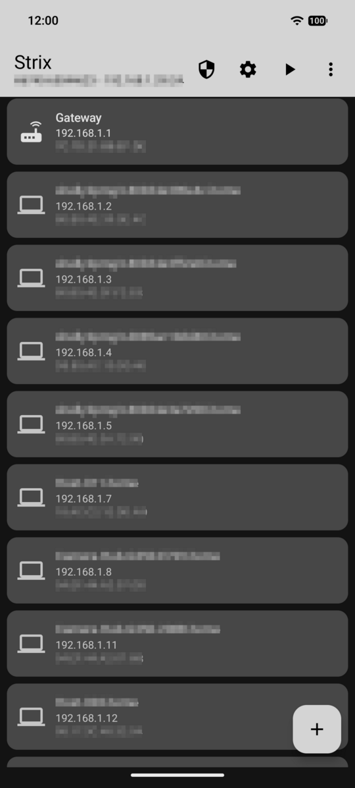&nbsp;
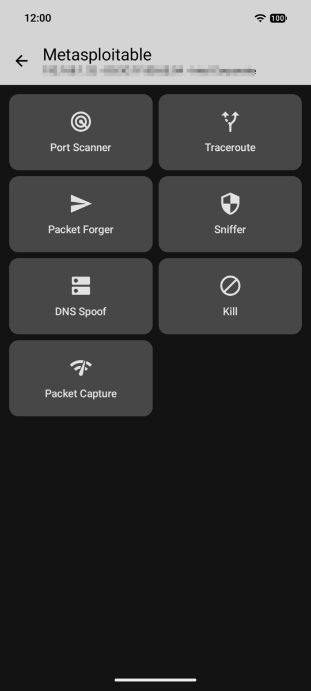&nbsp;
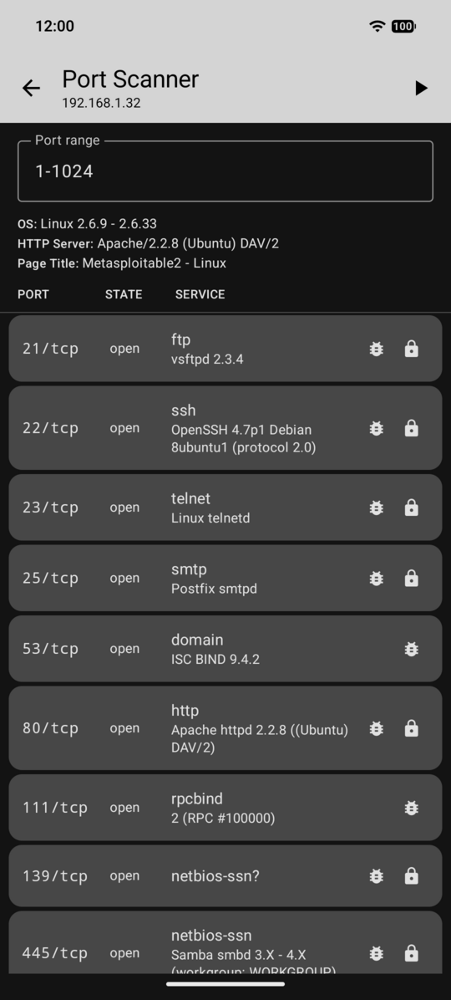&nbsp;
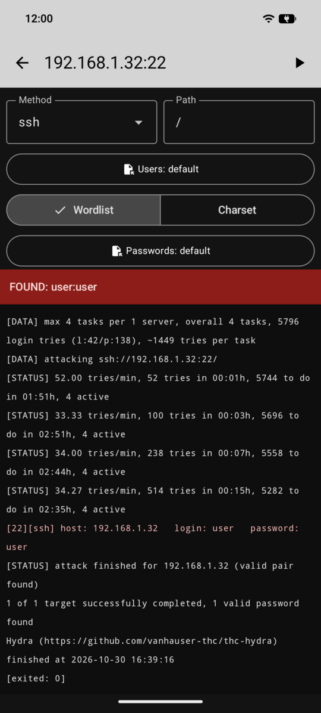

<sub>Host discovery &nbsp;·&nbsp; Host actions &nbsp;·&nbsp; Port scanner &nbsp;·&nbsp; Brute force</sub>

<br><br>

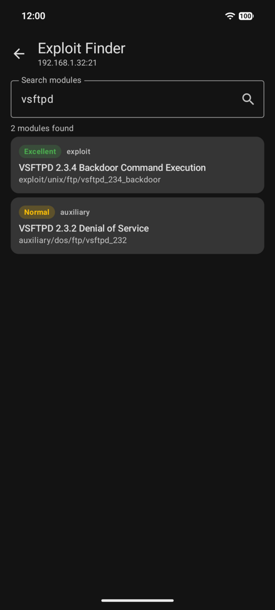&nbsp;
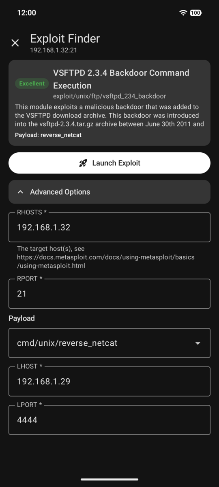&nbsp;
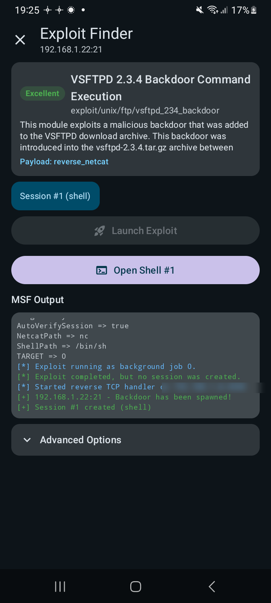&nbsp;
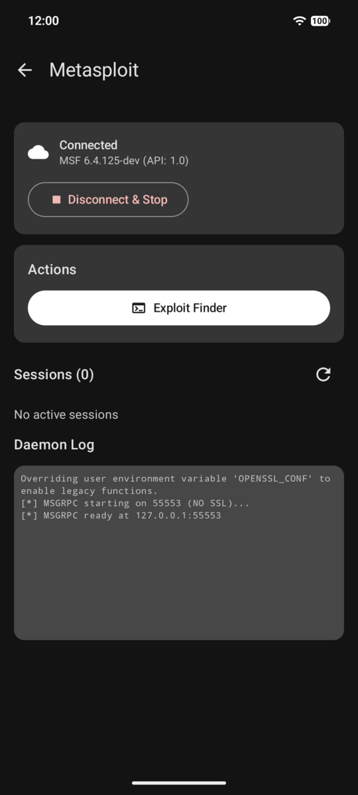

<sub>Exploit finder &nbsp;·&nbsp; Module options &nbsp;·&nbsp; Shell session &nbsp;·&nbsp; Metasploit</sub>

<br><br>

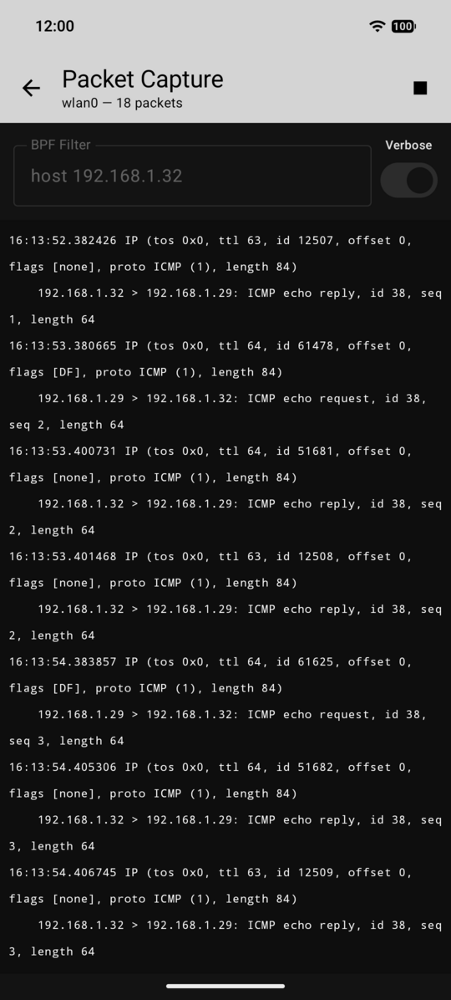&nbsp;
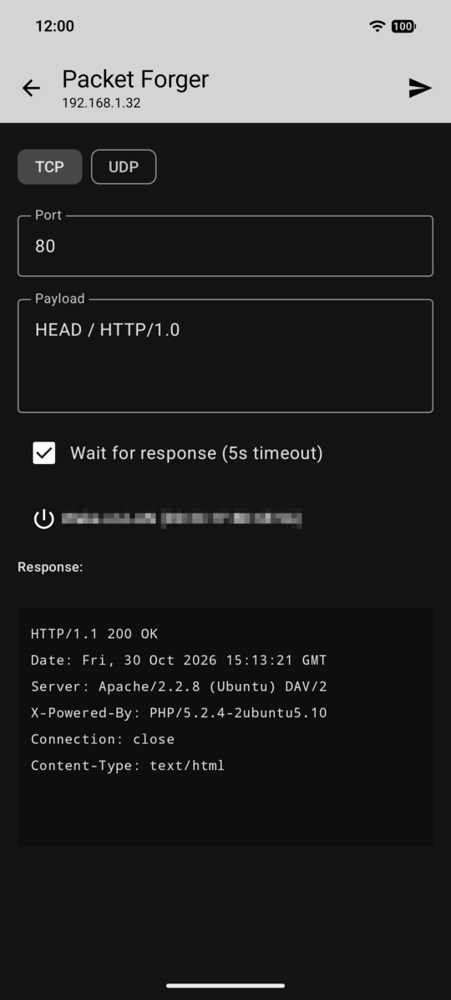&nbsp;
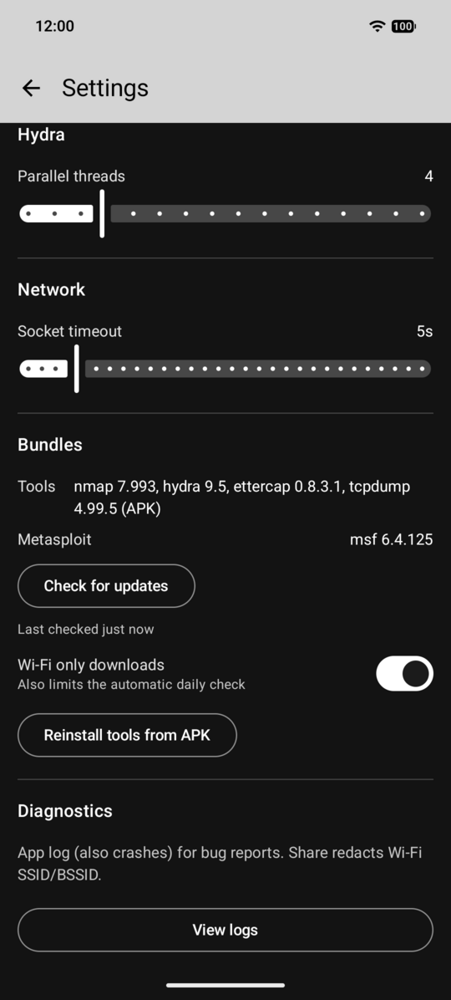&nbsp;
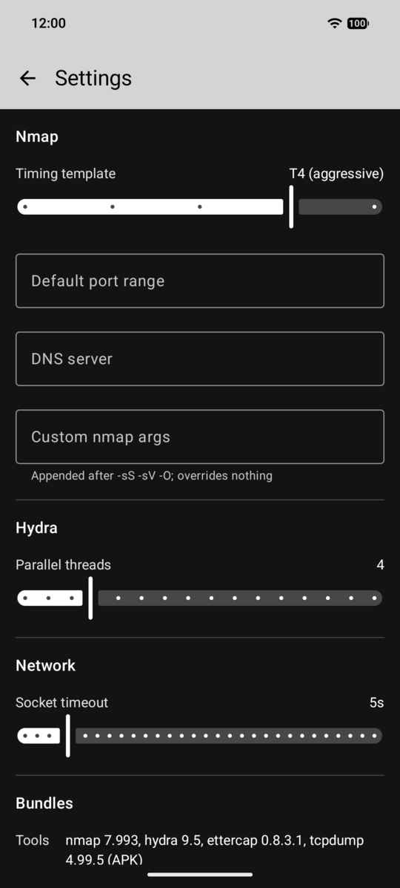

<sub>Packet capture &nbsp;·&nbsp; Packet forger &nbsp;·&nbsp; Updates &nbsp;·&nbsp; Settings</sub>

</div>

<sub>Screenshots were taken against <a href="https://docs.rapid7.com/metasploit/metasploitable-2/">Metasploitable 2</a>, a virtual machine that is vulnerable on purpose, made for practice.</sub>

## Getting started

### 1. Check your phone

| You need | Why |
|---|---|
| **Android 10 or newer** | The app targets modern Android |
| **A 64-bit ARM phone** (almost every phone from the last years) | The bundled tools are compiled for `arm64` |
| **Root** (Magisk, KernelSU, APatch…) | Scanning and sniffing need raw network access that Android only gives to root |

### 2. Install

1. Download `app-release.apk` from the [latest release](https://github.com/daboynb/strix/releases/latest).
2. Open it on the phone and allow installing apps from this source when Android asks.
3. Start Strix and **grant root access** when your root manager asks.

### 3. Your first scan

1. Connect the phone to the Wi-Fi network you want to test.
2. Tap **▶** at the top: Strix lists every device it finds.
3. Tap a device, then **Port Scanner** and **▶** to see what it is running.
4. From a port, tap the bug icon to **find exploits** or the lock icon to **brute force** it.

> [!TIP]
> Want a safe target to learn on? Run [Metasploitable 2](https://docs.rapid7.com/metasploit/metasploitable-2/) in a virtual machine on your PC (bridged network) and point Strix at it.

## Always up to date

Strix keeps its tools and Metasploit current **without reinstalling the app**.

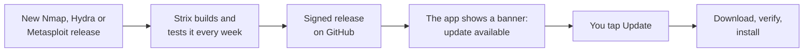

- **The tools** (Nmap, Hydra, Ettercap, tcpdump) are already inside the app and work offline from the first start.
- **Metasploit** is large, so it is not inside the app: open the **Metasploit** screen and tap **Download** the first time you need it (about 340 MB, about 1.2 GB of free space needed while installing).
- **Every week** new versions of Metasploit and the tools are built, checked and published automatically.
- **Once a day** the app checks for them and shows a banner. Nothing is downloaded until you tap **Update**. You can limit downloads to Wi-Fi.
- **Safe by design**: every package is digitally signed and checked before it is installed, and it is swapped in only when no scan or Metasploit session is running.

You can see the installed versions and check manually in **Settings → Bundles**.

## FAQ

<details>
<summary><b>Does it work without root?</b></summary>

No. Android does not allow normal apps to send raw packets, sniff traffic or run Nmap's ARP scan. Every feature of Strix needs root.
</details>

<details>
<summary><b>Is it legal?</b></summary>

Strix is legal to install and to use on your own network or with explicit written permission. Using it against networks or devices you don't control is illegal in most countries. You are responsible for how you use it.
</details>

<details>
<summary><b>Why does Metasploit need a separate download?</b></summary>

Metasploit plus its Ruby runtime is several hundred megabytes. Keeping it out of the APK keeps the app small for people who only need scanning, and lets Metasploit update on its own every week.
</details>

<details>
<summary><b>Something doesn't work. How do I report it?</b></summary>

Open the **⋮** menu → **Logs** → **Share**, and attach the file to a [new issue](https://github.com/daboynb/strix/issues). Please include your phone model, Android version and root method. The exported log has your Wi-Fi name removed.
</details>

<details>
<summary><b>Can I build it myself?</b></summary>

Yes. The app is a standard Gradle project in `strix/`:

```bash
cd strix
./gradlew assembleDebug
```

The native tools and the Metasploit runtime are cross-compiled with Docker (`strix/tools/build.sh`, `strix/ruby-msf/build.sh`); the CI workflows in `.github/workflows/` show the full pipeline.
</details>

## Credits

Strix stands on the shoulders of great projects:

- **[cSploit](https://github.com/cSploit/android)** and **dSploit**: the original Android pentest suites and the inspiration for Strix, including the Wi-Fi keygen algorithms.
- **[Nmap](https://nmap.org)**, **[Hydra](https://github.com/vanhauser-thc/thc-hydra)**, **[Ettercap](https://www.ettercap-project.org)**, **[tcpdump](https://www.tcpdump.org)**, **arpspoof**, **[Metasploit Framework](https://github.com/rapid7/metasploit-framework)** and **[Ruby](https://www.ruby-lang.org)**: the engines doing the real work. All credit for their capabilities goes to their authors.

## Support the project

Strix is the result of months of work. If it is useful to you:

- **Leave a star** on GitHub: it really helps other people find the project.
- **Report bugs** and share ideas in the [issues](https://github.com/daboynb/strix/issues).
- **Buy me a coffee:**

<a href="https://www.buymeacoffee.com/daboynb" target="_blank"></a>

## License

Strix is released under the **GNU General Public License v3.0**, like cSploit and dSploit from which it inherits code and ideas. See [`LICENSE`](LICENSE).

## Disclaimer

This software is provided for education and authorized security testing only. The authors accept no responsibility for misuse. You are solely responsible for making sure your use of Strix complies with all applicable laws.
